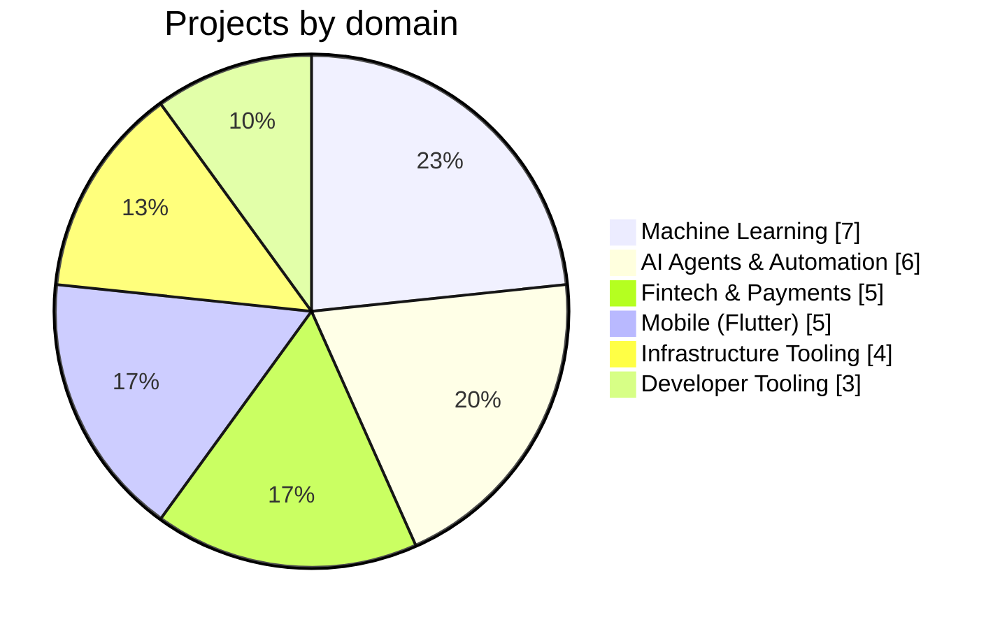
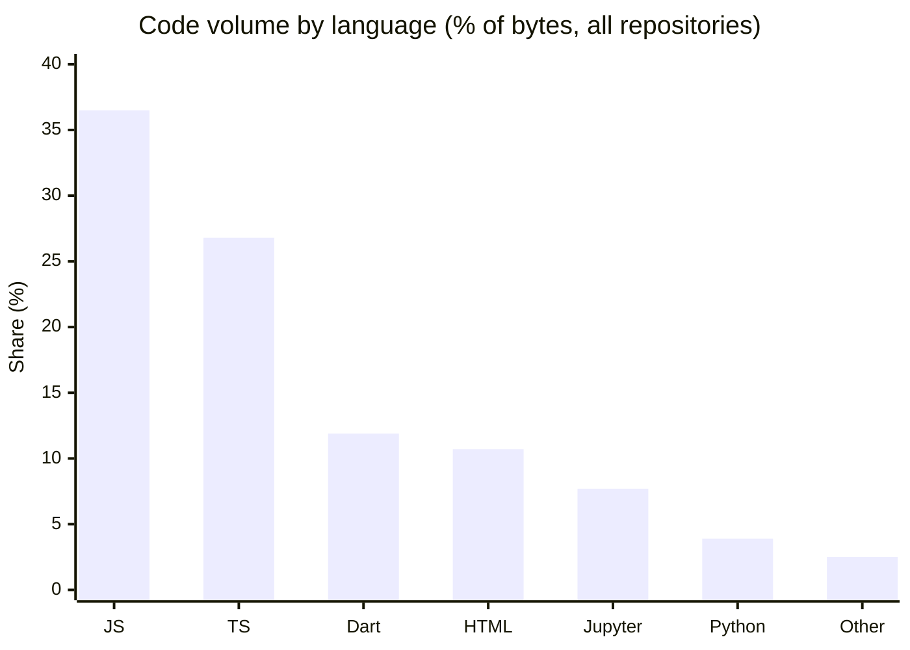

<!-- ============================== HEADER ============================== -->
<p align="center">
  
</p>

<p align="center">
  <a href="https://github.com/MahmouddGado">
    
  </a>
</p>

<p align="center">
  
  <a href="https://www.damen.com.eg"></a>
  
</p>

---

## 👋 About me

I'm an **Applied AI Engineer at Damen** and a **Flutter developer**. Most of my day goes into taking slow, manual business processes (payments, financial closing, compliance, recruiting, operations) and replacing them with **AI agents, ML models, and clean mobile/web apps** that run themselves.

```ts
const mahmoud = {
  role:        ["Applied AI Engineer @ Damen", "Flutter Developer"],
  focus:       ["AI agents", "Fintech automation", "Machine learning", "Mobile apps"],
  languages:   ["TypeScript", "JavaScript", "Dart", "Python"],
  mobile:      ["Flutter", "Cubit / Bloc", "Clean Architecture", "Firebase", "Supabase"],
  ai_ml:       ["LLM agents", "scikit-learn", "Pandas", "Jupyter", "Prompt engineering"],
  building:    "a ride-hailing app (passenger + driver) and open-source Claude Code skills",
  motto:       "If I do it twice, I automate it the third time.",
};
```

---

## 🚀 What I build

> 33+ repositories across my personal account and my organization. Most of them are private production systems, so they're summarized here by domain.

| | Domain | What it looks like | Projects |
|:-:|---|---|:-:|
| 💳 | **Fintech & Payments** | Bill-payment platform, automated monthly financial closing (commission tiers, net revenue), anti-money-laundering compliance system, credit-bureau report automation | **5** |
| 🤖 | **AI Agents & Automation** | A recruitment screening agent over WhatsApp, an operations agent that handles internal requests, an Outlook email analyzer and AI assistant, an AI pull-request reviewer | **6** |
| 🧠 | **Machine Learning** | GPS-spoofing detection, malicious-URL / cyber-attack detection, traffic-congestion prediction, symptom-to-disease classification, live language translation | **7** |
| 📱 | **Mobile (Flutter)** | A ride-hailing app with passenger and driver apps, a field-collection app, Firebase-backed prototypes | **5** |
| 🛠️ | **Infrastructure Tooling** | A UPS-triggered safe-shutdown service for ESXi hosts and VMs, a Telegram log gateway, data-offloading jobs | **4** |
| 🧩 | **Developer Tooling (Open Source)** | Claude Code skills and plugins for Flutter + Clean Architecture, an AI code reviewer | **3** |



---

## 🧰 Tech stack

<p align="center">
  
  <br/>
  
  <br/>
  
</p>

---

## ⭐ Featured open source

<p align="center">
  <a href="https://github.com/MahmouddGado/gado-skills">
    
  </a>
  <a href="https://github.com/MahmouddGado/connect-firebase-skill">
    
  </a>
  <br/>
  <a href="https://github.com/MahmouddGado/ai-reviewer">
    
  </a>
</p>

- **[gado-skills](https://github.com/MahmouddGado/gado-skills)**: agent skills for professional Flutter projects (Cubit, Clean Architecture, go_router, get_it). Install them through the Claude Code plugin marketplace or `npx skills`.
- **[connect-firebase-skill](https://github.com/MahmouddGado/connect-firebase-skill)**: a Claude Code skill that wires a Flutter module to Firebase Auth and Firestore end to end: models, services, state, screens, and form validation.
- **[ai-reviewer](https://github.com/MahmouddGado/ai-reviewer)**: an AI-powered code reviewer for pull requests.

---

## 📊 GitHub stats

<p align="center">
  
  
</p>

<p align="center">
  
</p>

<p align="center">
  
</p>

### 🧬 Language mix across all my projects (public + private)

```text
JavaScript        █████████████████████████████████████░░░░░░░░░░░░░   36.5 %
TypeScript        ███████████████████████████░░░░░░░░░░░░░░░░░░░░░░░   26.8 %
Dart              ████████████░░░░░░░░░░░░░░░░░░░░░░░░░░░░░░░░░░░░░░   11.9 %
HTML              ███████████░░░░░░░░░░░░░░░░░░░░░░░░░░░░░░░░░░░░░░░   10.7 %
Jupyter Notebook  ████████░░░░░░░░░░░░░░░░░░░░░░░░░░░░░░░░░░░░░░░░░░    7.7 %
Python            ████░░░░░░░░░░░░░░░░░░░░░░░░░░░░░░░░░░░░░░░░░░░░░░    3.9 %
Other             ██░░░░░░░░░░░░░░░░░░░░░░░░░░░░░░░░░░░░░░░░░░░░░░░░    2.5 %
```



---

## 🐍 Contribution snake

<p align="center">
  <picture>
    <source media="(prefers-color-scheme: dark)" srcset="https://raw.githubusercontent.com/MahmouddGado/MahmouddGado/output/github-snake-dark.svg" />
    <source media="(prefers-color-scheme: light)" srcset="https://raw.githubusercontent.com/MahmouddGado/MahmouddGado/output/github-snake.svg" />
    
  </picture>
</p>

---

## 🤝 Let's connect

<p align="center">
  <a href="https://www.damen.com.eg"></a>
  <a href="https://github.com/MahmouddGado"></a>
</p>

<p align="center"><i>"Automate the boring parts, so people can focus on the parts that matter."</i></p>

<p align="center">
  
</p>
